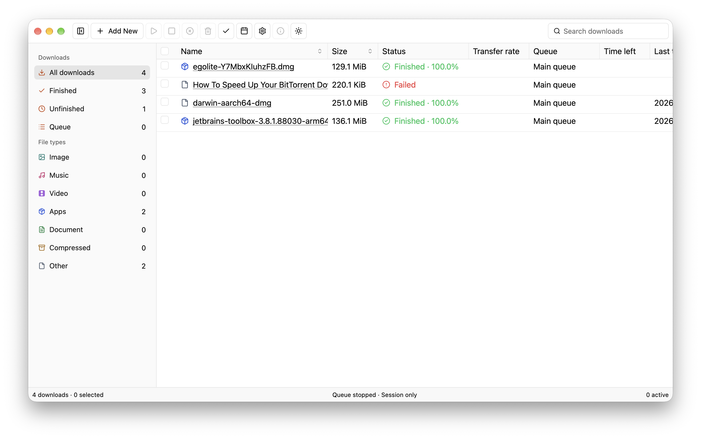

  

<h1 align="center">Ulos</h1>

A desktop download manager for links and torrent files.

  
  
  

## Download and install

**[Open the Releases page →](https://github.com/yan-ad/ulos/releases/latest)**

Choose the file for your computer from the assets actually listed on that release. No terminal or build tools are needed. Windows Setup installers and ARM64 additions are configured for the this build, not replacements for existing release assets. Older releases may still offer portable ZIPs.

| Computer | Download | Install |
| --- | --- | --- |
| Mac with Apple silicon (M1 or newer) | `macos-arm64.dmg` | Open the disk image and drag **Ulos** to **Applications**. |
| Mac with an Intel processor | `macos-x86_64.dmg` | Open the disk image and drag **Ulos** to **Applications**. |
| Windows, Intel/AMD x86-64 | `windows-x86_64-Setup.exe` (this build) | Open Setup, review the MIT license and third-party notices, then install for your Windows account. |
| Windows, ARM64 (for example Snapdragon) | `windows-arm64-Setup.exe` (this build) | Open the native ARM64 Setup when published; install for your Windows account. |
| Linux, Intel/AMD x86-64 (Ubuntu 24.04 baseline) | `linux-x86_64.tar.gz` | Extract the archive in your file manager, allow **Ulos** to run as a program, then open it. |
| Linux, ARM64 (Ubuntu 24.04 baseline) | `linux-arm64.tar.gz` | Extract the archive in your file manager, allow **Ulos** to run as a program, then open it (when published). |

Next-build Windows Setup needs no administrator access, does not launch Ulos automatically or take over file/magnet defaults, and includes an uninstaller. For historical Windows ZIP assets, extract the **entire** ZIP and open **Ulos.exe**. See the [installation guide](packaging/INSTALL.md).

These first builds are not Developer ID–signed/notarized on macOS or publisher-signed on Windows. Your system may show a security warning. Review the source and release before deciding whether to allow it; do not disable system security. On macOS, an approved exception can be made in **System Settings → Privacy & Security**. Linux packages depend on the system libraries listed in the release notes.

## What you can do

- Add an HTTP/HTTPS link or open/drop a v1, v2 or hybrid `.torrent` file with **Add New** (this build; see [release notes](RELEASE_NOTES.md)).
- Organize downloads into named queues and set one-time or weekly schedules.
- Pause supported transfers, track progress and speed, and choose how file conflicts are handled.
- Use light, dark, or system appearance.
- Check for a new version from **Help → Check for Updates**. **What's New** opens its GitHub release notes; updates are installed manually from Releases.

## Before you start

Ulos is early software. Keep it open for schedules to run. Queue sources and schedules are not restored after quitting; saved history cannot restart a transfer.

In the this build, torrent format detection and engine selection are automatic. V1 defaults to tracker-only downloads without payload uploads. V2/hybrid downloads use a bundled native engine and require explicit **Allow peer uploads while downloading** consent; public DHT and download/upload/peer limits are optional with that consent. Known-private payload transfers never use DHT. The Add Address field (Add New or ⌘N) accepts HTTP/HTTPS or magnet links; the Torrent file draft also retains a magnet input. Magnets require explicit **Resolve magnet**: native metadata-only discovery uses trackers/direct numeric peers, with a separate default-off public-DHT checkbox. Private status is unknown before resolution, so opting into DHT can expose a private hash. Resolving does not start or queue payload downloads. V2/hybrid magnets needing piece layers fail closed; choose a `.torrent` file instead. Local discovery, port forwarding, post-completion seeding and durable resume remain unsupported; metadata and safety limits still apply. See the [torrent guide](docs/TORRENTS.md). These changes are not retroactive to existing release assets. Only download content you have permission to use.

## Help and feedback

[Report a problem](https://github.com/yan-ad/ulos/issues) · [Release notes](https://github.com/yan-ad/ulos/releases) · [Developer guide](docs/DEVELOPMENT.md)

MIT licensed. See [third-party notices](THIRD_PARTY_NOTICES.md) for included software.
